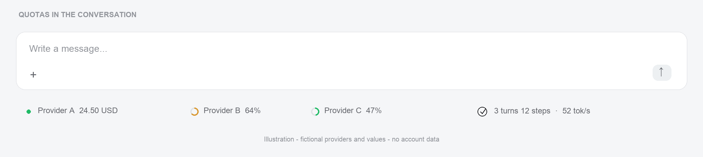
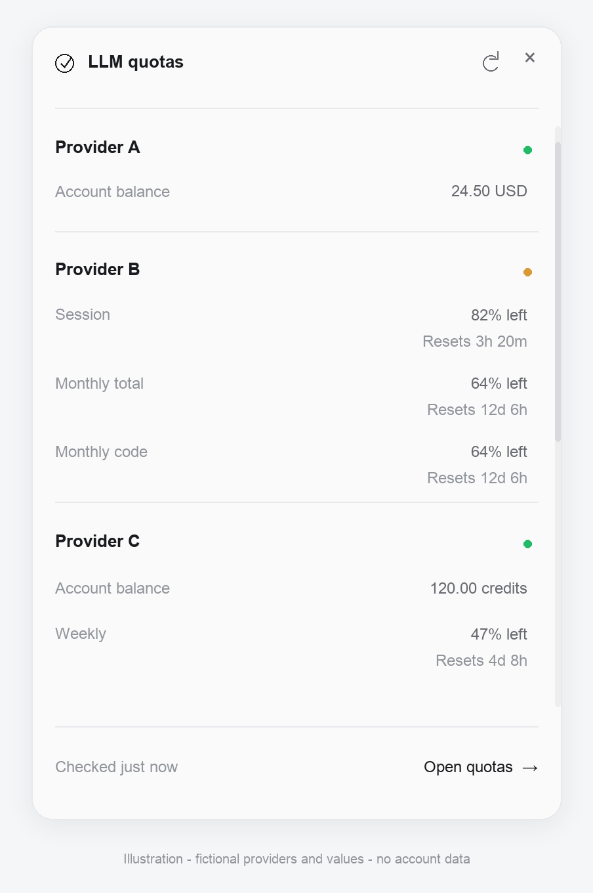
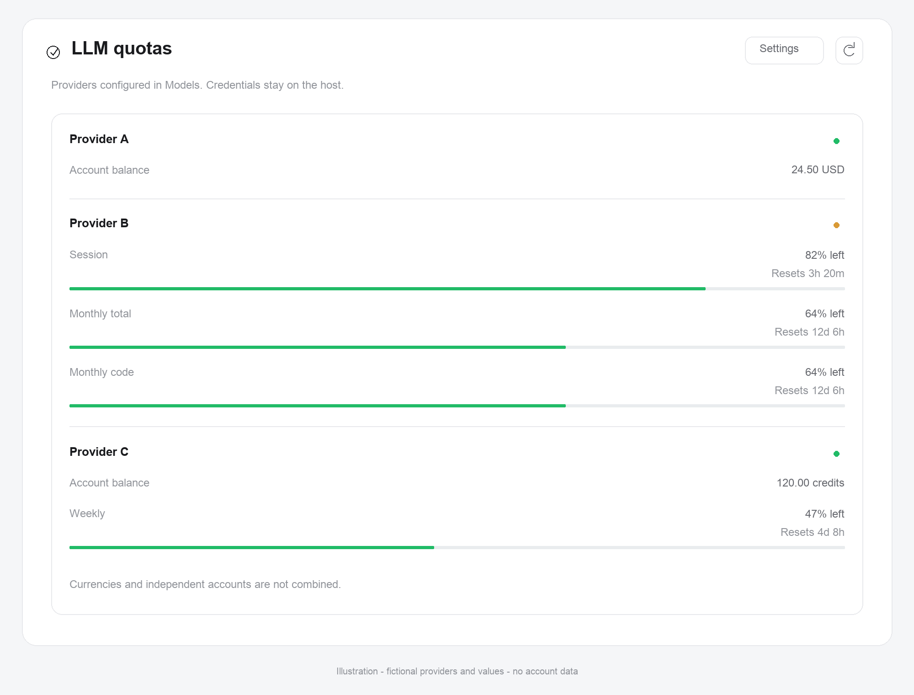

# LLM quotas for DeepSeek Harness

English (default) · [Русский](README.ru.md) · MIT · Host + Web Client

**Inspired by [hermes-quota-plugin](https://github.com/rarf/hermes-quota-plugin/) by [rarf](https://github.com/rarf).** The status chips, layered quota views and provider API research informed this independent DSH implementation. Hermes credential discovery is deliberately not included. MIT attribution: © 2026 rarf.

Show provider balances and subscription limits using **only providers and stored authorization configured in Settings → Models**. Credentials stay on the Host.

## Languages

English is the default language for this README, package descriptions, repository metadata and release notes. Russian documentation is maintained separately in [README.ru.md](README.ru.md). The plugin's Russian UI translation remains available through the DSH locale setting; it does not replace the English defaults.

## Interface

> **Generated illustrations, not real account screenshots.** All `Provider A/B/C` labels, balances, percentages, timings and conversation statistics are fictional. Real account names, identifiers, emails, tokens, session titles and file paths are never used. Illustrations show the light theme; the installed plugin follows the DSH theme.

### Quota strip in the conversation



### Compact widget



### Full quota panel



Images are generated from fixed fictional data by the [documentation generator](src/docs/generate_previews.py). It does not read Models settings, authorization or source screenshots. To regenerate, use Python with Pillow:

```sh
python src/docs/generate_previews.py
```

Pillow is only needed for generating documentation images, not for installing or running the plugin.

## Features

- Adaptive single-line provider indicators to the left of Session statistics, below the composer; no strip borders or background.
- When space is limited, `+N` opens a compact list of hidden providers. Hover/focus details, the all-provider widget, and the full sidebar panel remain available.
- Settings for visibility, all providers / lowest quota, reset formatting, refresh interval, provider switches and per-currency low-balance thresholds. Reset countdowns live in compact details, not the strip.
- Alphabetical account ordering by display name, case-insensitive with natural number ordering.
- The agent's `quota_status` tool shares the same read, refresh and settings operations as the UI.

Balances, API-key budgets and subscription windows are different metrics. Currencies, independent accounts and windows are never summed. Missing values are not presented as zero.

### Adaptive overflow and low balances

Only accounts that do not fit are hidden. Accounts with a known **0% remaining** in any quota window, or **all** reported balances strictly below their configured currency thresholds, are hidden first. Within each priority tier, removal proceeds from the end; visible accounts keep their alphabetical order. Wide containers show every enabled provider, including exhausted ones. Errors, stale data, unsupported accounts, missing metrics and currencies without thresholds are never classified as zero.

Settings → LLM quotas → **Low-balance thresholds** provides editable values for USD, CNY and each reported currency. Defaults are **USD 1** and **CNY 7**, manual approximate equivalents, not live FX quotes. A balance exactly at its threshold is not low. A funded CNY balance keeps DeepSeek in the normal tier even when its USD balance is zero. Balances are not added across currencies. Empty inputs disable that currency. The same preferences are exposed to agents:

```json
{"action":"settings","patch":{"lowBalanceThresholds":{"USD":1,"CNY":7,"EUR":0.9}}}
```

The map replaces all previous thresholds; `{}` disables balance-based deprioritization but not zero-quota prioritization. Existing settings migrate to defaults when this field is absent. The strip uses its own measured container, local text measurements, resize observation and font readiness rather than monitor detection or host DOM inspection.

The adaptive dock sizing accounts for DSH's public `data-slot` outlet anchor, including its `display:contents` wrapper. The strip retains a measured nonzero intrinsic basis, preventing collapse inside content-sized containers. A narrowly scoped owner rule allocates available composer width only while quota is visible; no app files, hashed class names or parent DOM traversal are used.

For troubleshooting, `quota_status` read/refresh also returns `layout`: up to eight anonymous live measurements retained in Host memory only. They include viewport/own-element/chip widths, visible/hidden counts and flex factors, but no account names, IDs, paths or credentials. Reporting does not query providers or persist history. These measurements are not a substitute for visual acceptance.

Provider indicators are right-aligned inside the adaptive quota allocation (`justify-content:flex-end`). The last provider or `+N` stays next to Session statistics, with spare width to the left; provider ordering and overflow priority are unchanged.

See [Changelog](CHANGELOG.md) for version 1.1.0. The illustrations above predate adaptive overflow and are not visual verification of the current strip.

## Provider support

| Provider | Available metrics | Limitations |
|---|---|---|
| DeepSeek | Separate CNY / USD balances | API credit balance, not a subscription or per-key cap |
| Moonshot global / CN | Regional API balance | Not Kimi Coding; keys are not tried across regions |
| Kimi Coding | Usage windows | Stored API key; its OAuth flow is not connected in v1 |
| OpenAI Codex | Quota windows and credits | Requires a stored Codex OAuth grant, not an ordinary OpenAI key |
| Z.ai / Zhipu | Coding-plan limits | Regional monitor endpoints; contracts may change |
| OpenRouter | Budget remaining for the configured key | Not the shared account wallet |

See [provider adapters](src/providers.js) for the implemented contracts. Other configured providers show an explicit unsupported or authentication status instead of invented metrics. DeepSeek Account sign-in and the OpenAI Responses “Sign in with ChatGPT” flow are not substitutes for these API credentials.

Kimi may report the same five-hour Session in both `usages.limit_5h` and an unscoped 300-minute `limits` entry. The structured window takes precedence; the legacy entry remains a fallback for missing/invalid structured metrics and can fill a missing reset timestamp. Monthly, explicitly scoped and unknown windows are not deduplicated by their labels or values.

## Privacy and safety

- Providers come from the configurable Models directory and their corresponding settings profiles.
- Only explicitly stored Models references / provider-owned records are read. Environment fallbacks, `.env`, CLI files, cookies and OS credential discovery are not used.
- OAuth grants are never refreshed or modified by this plugin. Expired credentials require sign-in through Models or refresh by their owning adapter.
- Tokens, JWT emails and raw provider error bodies never reach the browser or tool output.
- Fixed HTTPS endpoint allowlists, no redirects or arbitrary proxy URLs, bounded responses and timeouts.
- Cached checks, manual-refresh cooldown, bounded concurrency and explicit stale-data status.
- Display preferences are profile-wide. Disabling a quota check does not modify Models.
- No paid LLM completion requests are made to check quotas.

## Install from GitHub

Install `github:pnpwin/dsh-quota#v1.1.0` through Plugins or ask the DSH agent to run:

```json
{"action":"install_bundle","target":"github:pnpwin/dsh-quota#v1.1.0"}
```

Use a full commit SHA instead of the tag for immutable pinning. Do not activate the local and GitHub bundles simultaneously: they provide the same slots and tool.

The plugin requires no build, install scripts or external runtime dependencies. Follow the manager's `application`, warnings and `nextStep`; replacing loaded backend modules may require a restart. Refreshing the browser alone does not update Host code.

## Development and verification

All executable code is under [src](src/): [Host entry](src/index.js), [backend](src/backend.js), [Web Client](src/client.js), [provider adapters](src/providers.js), [tests](src/tests/) and the [documentation generator](src/docs/generate_previews.py). The root contains only manifests, DSH resources and documentation.

```sh
npm test
npm run check
npm pack --dry-run
```

The 1.1.0 suite has **80 tests**, using `node:test`, synthetic fixtures and mocked network / credential services. Coverage includes parsers, endpoint and credential boundaries, caching, settings persistence, adaptive layout contracts, anonymous diagnostics, floating geometry, image metadata and documentation links. Tests make no paid provider calls. Live Desktop measurements confirmed adaptive visibility, and the final right-aligned placement was accepted through user review. This is not automated multi-monitor or light/dark-theme visual coverage; illustrative images are **not** browser-render verification.

No context-saving or token-reduction benchmark is claimed. Byte sizes, synthetic counters and heuristic estimates are not actual provider-reported token measurements. Provider quota data in the running plugin comes from provider endpoints, not from these example images or a session-token estimate.

The suite includes adaptive overflow, currency-threshold validation/persistence, and Kimi mixed-schema regressions covering duplicate Session windows, invalid-data fallback, reset metadata, boundary values and independent scopes. Pure fit/priority tests and CSS contract checks are not browser layout or multi-monitor verification. Changing display settings remounts the Host plugin, so an already-running agent turn may need a fresh turn to regain its newly registered tool definition.

## References

- [Hermes quota plugin](https://github.com/rarf/hermes-quota-plugin/), researched commit `39708d74349d482b568009835c54cd5b6a123d0c`.
- [DeepSeek balance API](https://api-docs.deepseek.com/api/get-user-balance).
- [Moonshot global](https://platform.kimi.ai/docs/api/balance.md) / [CN](https://platform.kimi.com/docs/api/balance.md) balance APIs.
- [OpenRouter limits](https://openrouter.ai/docs/api/reference/limits).
- [ZCode quota contract](https://github.com/zai-org/zcode/blob/aac4755666d09fdcd70272fcf063c077a639015f/docs/bigmodel-coding-plan-usage-quota.md): raw API key authorization differs from the Bearer form observed in Hermes.

Original DSH integration, UI and artwork. See [LICENSE](LICENSE).
