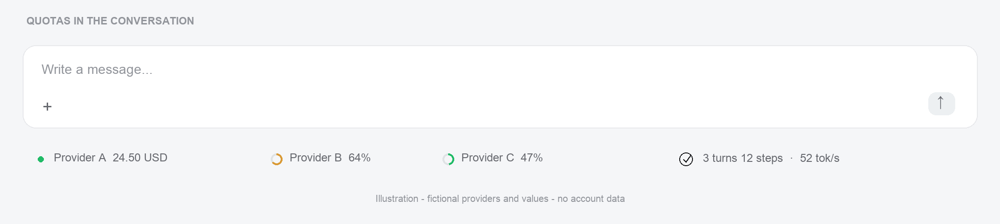
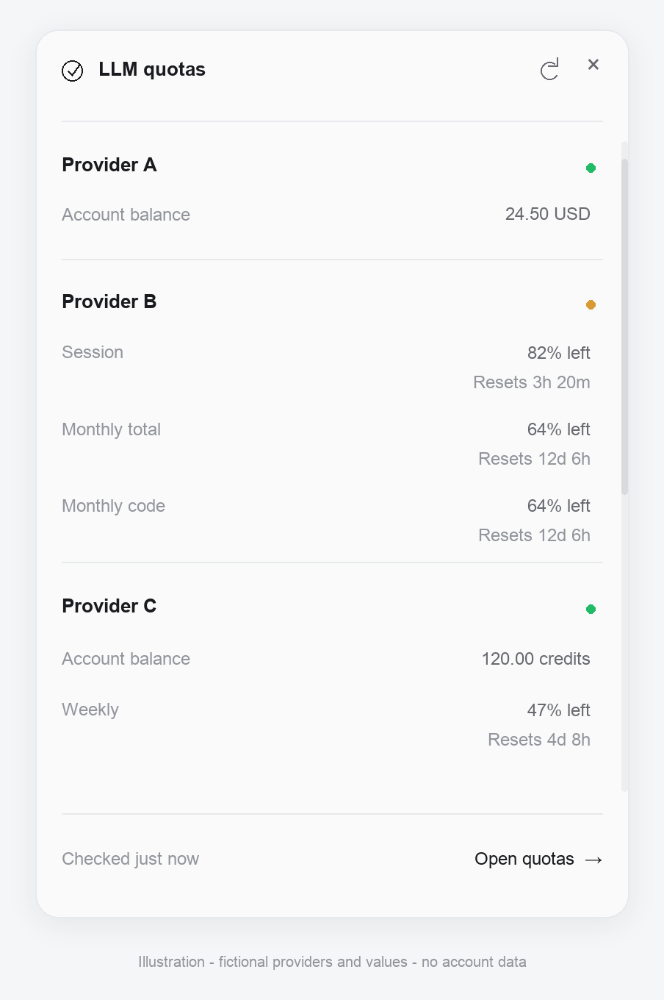
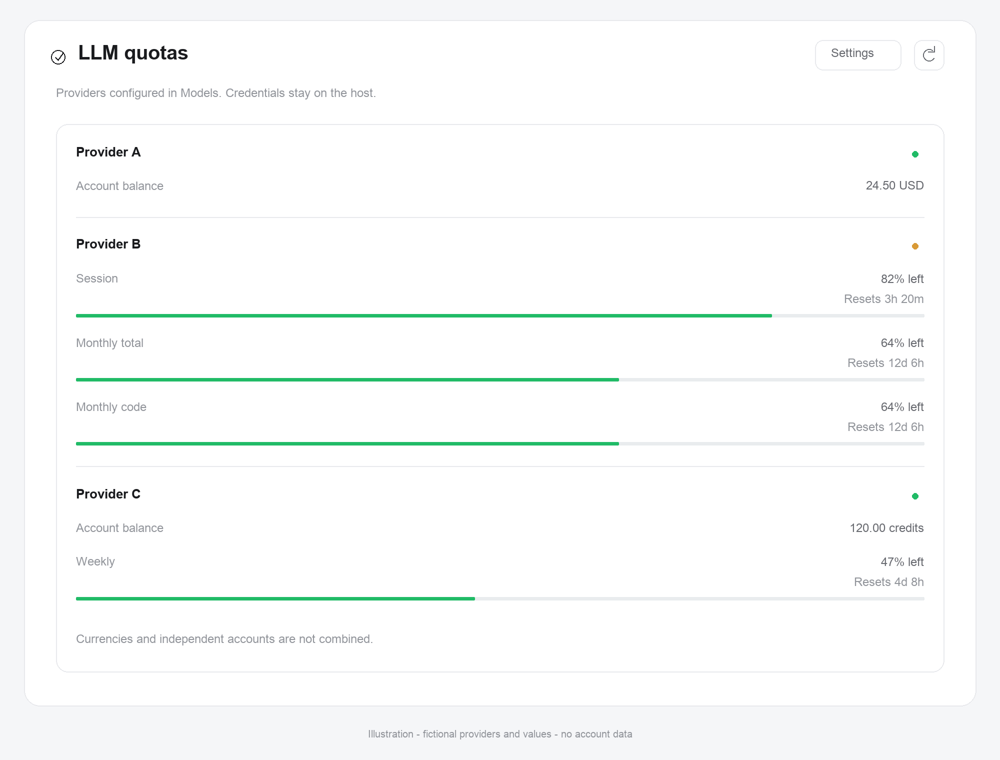

# Квоты LLM для DeepSeek Harness

[English](README.md) · Русский

[GitHub](https://github.com/pnpwin/dsh-quota) · MIT · Host + Web Client · весь исполняемый код в [src](src/)

**Источник вдохновения — [hermes-quota-plugin](https://github.com/rarf/hermes-quota-plugin/) от [rarf](https://github.com/rarf).** Оттуда взяты идея строки квот, подсказок и многоуровневого виджета, а также сведения о контрактах API провайдеров. Это самостоятельная реализация для DSH: механизм поиска авторизации Hermes не переносился. Сохраняется атрибуция MIT, © 2026 rarf.

Постоянный Host + Web Client плагин. Использует **только провайдеров и сохранённую авторизацию Settings → Models**; ничего не импортирует из Hermes и внешних CLI.

## Интерфейс

> **Демонстрационные иллюстрации, не снимки реальных аккаунтов.** Все подписи `Provider A/B/C`, суммы, проценты и сроки вымышлены. Реальные имена и идентификаторы аккаунтов, email, токены, названия сессий и пути файлов не используются. Изображения показывают светлую тему; работающий плагин следует текущей теме DSH.

### Панель квот в диалоге



### Компактный виджет



### Общая панель



Изображения создаются [генератором в src](src/docs/generate_previews.py) исключительно из фиксированных демонстрационных данных. Он не читает настройки Models, авторизацию или исходные скриншоты. Для воспроизведения нужен Python с Pillow: `python src/docs/generate_previews.py`.

## Где находится

1. Под полем ввода сессии, слева от Session statistics: краткие провайдеры, баланс либо минимальный остаток окна в процентах. Кольцо означает **остаток**, не расход. Цвет и текст отражают доступность/свежесть.
2. Наведение мыши или фокус клавиатуры: подробности всех окон, валют и времени сброса.
3. Нажатие на провайдера: компактный виджет. Escape, кнопка закрытия и клик снаружи закрывают его.
4. «Открыть квоты» либо пункт «Квоты LLM» в левом меню: большая панель с отдельными карточками.
5. Settings → «Квоты LLM» или «Настройки» в панели: строка квот, режим «все / минимальная», время сброса, относительные/точные даты, интервал 60–3600 секунд и включённые провайдеры. Настройки общие для текущего профиля и сохраняются через Config editor.

Агент получает инструмент `quota_status`: чтение, обновление и изменение тех же настроек через общую backend-операцию. Ключи инструмент не возвращает.

## Подход и границы

Универсального API квот нет. Бюджет API-ключа, баланс аккаунта и лимит подписки — разные величины. Мы не вычисляем квоту из числа токенов сессии и не называем неизвестные значения нулём. Валюты, окна и аккаунты не суммируются. Прогнозы расхода и уведомления из скриншотов Hermes не копируются: они не нужны для пяти запрошенных поверхностей квот.

Приоритет: прямые read-only API провайдеров → явное сообщение об отсутствии доступа/API. Скрейпинг кабинетов, чтение CLI-файлов и сбор cookies отвергнуты как несовместимые с ограничением источника авторизации. Учёт затрат самой сессии тоже не заменяет остаток провайдерской подписки.

### Проверенные контракты

| Провайдер | Что можно получить | Ограничения |
|---|---|---|
| DeepSeek | Отдельные балансы CNY/USD | Не лимит подписки и не per-key budget |
| Moonshot global / CN | API balance USD / CNY | Не Kimi Coding; регионы не взаимозаменяемы |
| Kimi Coding | Окна `/coding/v1/usages` с сохранённым API-ключом | Не обычный Moonshot API balance; OAuth этого провайдера в v1 не подключён |
| OpenAI Codex | Лимиты окон и credits | Нужен сохранённый OAuth именно Codex; API key не заменяет подписку |
| Z.ai / Zhipu | Coding-plan quota, отдельные региональные endpoints | Monitor endpoint, контракт может меняться |
| OpenRouter | Остаток/лимит конкретного ключа | Не баланс общего кошелька |

Список фактически реализованных адаптеров задаёт [providers.js](src/providers.js). Остальные настроенные провайдеры видны с явным статусом неподдерживаемого API/авторизации, а не фиктивными показателями. DeepSeek Account (вход в сам DSH) не используется вместо API-ключа Models. Sign in with ChatGPT для OpenAI Responses — другой OAuth flow, не Codex.

## Безопасность и актуальность

- Провайдеры обнаруживаются через `llm.listConfigurableProviders()` и адресуемые профили `settings.describe()`, как на странице Models. Dormant-каталог не считается настроенным аккаунтом.
- API key читается только по привязанной к Models ссылке и только при подтверждённом сохранённом источнике. `env`, `.env`, CLI auth files, браузерные cookies, keychain и другие внешние источники не используются.
- OAuth читается только из записи настроенного провайдера Models. Плагин не меняет и не обновляет refresh tokens; просроченный вход требует повторной авторизации через Models или обновления токена владельцем адаптера.
- В браузер и tool output поступают только нормализованные метрики, разрешённые названия и безопасные сообщения ошибок, без токенов, email из JWT и сырых тел ошибок.
- HTTPS-запросы идут на фиксированные разрешённые endpoints; произвольные прокси и кастомные URL не запрашиваются. Redirects не выполняются. Ключи не перебираются между регионами.
- Проверки кешируются; ручное обновление имеет ограничение частоты. Таймаут и размер ответа ограничены. При временном сбое последние данные явно помечаются устаревшими; после истечения срока не выдаются за актуальные.
- Отключение провайдера в настройках квот не меняет Models. Настройки и данные разделяются на уровне текущего DSH-профиля, не сессии.
- Никаких новых LLM-запросов: проверяются только баланс/usage endpoints.

## Разработка и установка

Весь исполняемый код находится в [src](src/): [Host entry](src/index.js), [backend](src/backend.js), [адаптеры](src/providers.js), [Web Client](src/client.js) и [тесты](src/tests/). В корне остаются только манифест, patch, документация и ресурсы. Экспорты пакета ведут непосредственно в [src](src/).

Аккаунты во всех списках (строка сессии, компактный виджет, большая панель и настройки) сортируются по отображаемому имени, без учёта регистра; числа сравниваются естественным образом. Сортировка не скрывает аккаунты и не меняет настройки Models.

```sh
npm test
npm run check
npm pack --dry-run
```

### Установка из GitHub

В DSH попросите агента установить bundle из `github:pnpwin/dsh-quota#v1.0.0` либо укажите этот spec в установке пакета через Plugins. Для инструмента `plugin_manager`:

```json
{"action":"install_bundle","target":"github:pnpwin/dsh-quota#v1.0.0"}
```

Версия закреплена тегом; для воспроизводимой установки можно заменить тег на полный commit SHA. Пакет не требует сборки, внешних зависимостей или install-скриптов. Не устанавливайте одновременно локальный и GitHub bundle: они предоставляют одни и те же UI-слоты и инструмент `quota_status`.

Для разработки используйте `git clone https://github.com/pnpwin/dsh-quota.git`, затем установите директорию через `plugin_manager`. Не редактируйте профиль вручную. Первичная установка может примениться сразу; если менеджер требует перезапуск, следуйте его `nextStep`. Замена уже загруженного backend-модуля требует нового поколения модулей/перезапуска приложения; сама перезагрузка страницы не обновляет backend.

## Визуальный стиль

Подсказки и компактный виджет используют нативную поверхность всплывающих панелей DSH: `--dsw-specific-menu`, `--dsw-menu-backdrop-filter`, `--dsw-elevation-prominent` и `--dsw-radius-lg` (с безопасными fallback). Это поверхность меню, не белый фон страницы. Значения метрик используют secondary-текст, названия и время сброса — tertiary. Внутренние отступы 16 px; во всплывающих окнах текст 12 px и строки «название — значение» с шагом 4 px, на основной панели — 13 px. Убраны цветной фон overlay, вложенные карточки, крупные цифры и круговые диаграммы из popup; маленькие кольца остаются только в строке сессии. Основная панель использует тот же плоский список с тонкими разделителями и небольшими полосами остатка.

Ширина подсказки — до 320 px, компактного виджета — до 360 px. Положение рассчитывается по реальной высоте содержимого относительно нажатого индикатора: сверху с зазором 8 px, при нехватке места снизу; у краёв сохраняются поля. Длинные списки прокручиваются внутри, заголовок и действия остаются доступны. Полоса прокрутки вынесена точно на правую грань окна. Перед ней оставлено компактное внутреннее поле 16 px вместо прежнего чрезмерного запаса 32 px. На узких экранах сохраняется тот же запас, а вынос до грани рассчитывается через общий padding-токен. Используется `scrollbar-gutter: stable`. Escape, закрытие снаружи и возврат фокуса сохранены.

## Проверка реализации

В основной ветке проходят 46 unit/security/layout/geometry/docs тестов и синтаксические проверки. Неизменяемый релиз v1.0.0 изначально содержал 43 теста; последующие проверки иллюстраций относятся к документации основной ветки. Порядок строки квот: `local-llm-quota: -1` → `activity: 0` (Session statistics: ходы, шаги, скорость) → `usage: 1` (токены, cache hit, контекст). Предыдущий вариант `order: 0.5` ошибочно ставил квоты между двумя секциями; тест теперь проверяет расположение перед `activity`, а не только перед `usage`. После установки подтверждены активные регистрации строки сессии, popup, основной панели и раздела настроек в подключённом Client; живые запросы DeepSeek, Codex и Z.ai успешно вернули метрики. Сохранение настроек проверено штатным инструментом; изменённый тестовый режим восстановлен без перезаписи других пользовательских предпочтений.

Визуальная приёмка (реальные клики/скриншоты, светлая и тёмная темы, отображение иконки) без управления подключённым браузером не выполнялась. Регистрация слотов не равнозначна визуальной приёмке.

Изменение настроек пересоздаёт Host-экземпляр плагина. DSH может исключить прежнее определение `quota_status` из уже выполняющегося хода агента; в новом ходе инструмент доступен. Web UI использует новые HTTP handlers и не зависит от этого ограничения допуска инструментов.

### Методика тестирования и измерений

Тесты используют `node:test`, синтетические fixtures и моки сети/авторизации; платные вызовы LLM не выполняются. Отдельно проверяются парсеры, границы доступа к ключам, кеш, сохранение настроек, порядок UI, геометрия, PNG-метаданные и ссылки документации. Иллюстрации не заменяют проверку работающего интерфейса браузером.

Бенчмарки экономии контекста или токенов для этого плагина не заявляются. Размеры в байтах, вымышленные счётчики на иллюстрациях и эвристические оценки нельзя считать реальными provider tokens. Рабочий плагин получает квоты от endpoints провайдеров, не рассчитывает их по демонстрационным картинкам или числу токенов сессии.

## Исследование

- [Hermes quota plugin](https://github.com/rarf/hermes-quota-plugin), исследованный commit `39708d74349d482b568009835c54cd5b6a123d0c`; [провайдеры](https://github.com/rarf/hermes-quota-plugin/tree/39708d74349d482b568009835c54cd5b6a123d0c/quota_providers).
- [Moonshot global balance](https://platform.kimi.ai/docs/api/balance.md), [Moonshot CN balance](https://platform.kimi.com/docs/api/balance.md).
- [DeepSeek balance API](https://api-docs.deepseek.com/api/get-user-balance).
- [OpenRouter key API](https://openrouter.ai/docs/api/reference/limits).
- [ZCode quota contract](https://github.com/zai-org/zcode/blob/aac4755666d09fdcd70272fcf063c077a639015f/docs/bigmodel-coding-plan-usage-quota.md): требует raw API key в Authorization, тогда как Hermes использует Bearer; это расхождение учтено, но не означает универсальную стабильность monitor API.

Собственная реализация интерфейса и DSH-интеграции. Оригинальная SVG-иконка. Hermes распространяется по MIT, © 2026 rarf; его внешний поиск авторизации сознательно не переносился.
